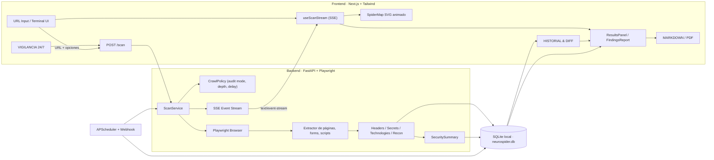
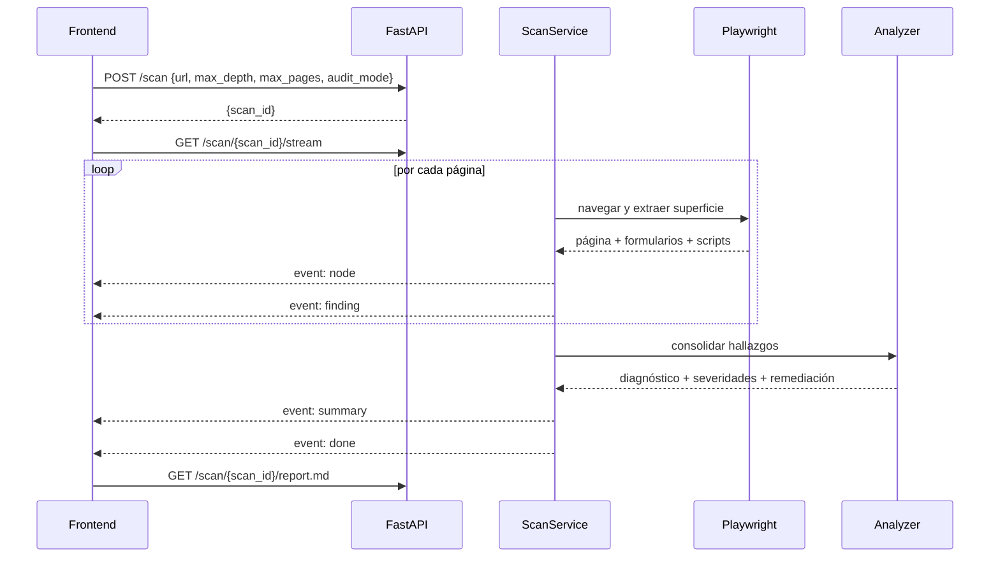

# NeuroSpider

Suite de ciberseguridad pasiva sobre **alcances autorizados**: reconocimiento en vivo, historial y comparador "antes vs. después", vigilancia 24/7 e informes Markdown/PDF corporativos, todo con SQLite local sin servidores externos.

> NeuroSpider no realiza explotación activa, escaneo de puertos ni pruebas intrusivas. Úsalo solo sobre sitios propios o con autorización explícita.

## Objetivo

El usuario ingresa una URL autorizada, un backend con **FastAPI + Playwright** recorre el sitio de forma controlada y analiza:

- Cabeceras de seguridad: CSP, HSTS, X-Frame-Options, X-Content-Type-Options y Referrer-Policy.
- Formularios, inputs, endpoints y parámetros como superficie de entrada.
- Archivos JavaScript, comentarios HTML, correos, tokens, claves y rutas internas.
- Tecnologías detectadas, frameworks y cookies sin `HttpOnly` o `Secure`.
- `robots.txt` y `sitemap.xml` como fuentes de descubrimiento, sin bloquear el análisis.
- Certificados TLS vencidos o autofirmados como hallazgo de severidad `ALTO`, sin detener el escaneo.
- Errores `403`, `429`, timeouts y fallos de navegación por página como eventos `error`, continuarando con el resto del alcance.
- Subdominios publicados en certificados mediante consulta pasiva a Certificate Transparency (crt.sh).
- Huellas de WAF/CDN (Cloudflare, AWS CloudFront/WAF, Akamai, Imperva y Sucuri) desde cabeceras y cookies.
- Persistencia local de cada auditoría, historial consultable, comparación de riesgos y re-escaneo programado con alertas webhook.

La URL se normaliza automáticamente: `ejemplo.com` se convierte en `https://ejemplo.com` y se siguen redirecciones HTTP→HTTPS. El frontend **Next.js + Tailwind** muestra en tiempo real el mapa animado de la araña, métricas, hallazgos por severidad y un **Diagnóstico Ejecutivo de Seguridad Pasiva** generado por reglas locales o, si se configura una clave, por OpenAI/Gemini.

## Arquitectura



## Flujo de eventos (SSE)



## Severidades

| Severidad | Uso |
| --- | --- |
| `CRITICO` | Credenciales o secretos probablemente explotables |
| `ALTO` | Exposición o configuración con impacto elevado |
| `MEDIO` | Debilidades que requieren corrección planificada |
| `BAJO` | Información menor o endurecimiento recomendado |
| `INFO` | Inventario, superficie y evidencia de reconocimiento |

## Estructura del repositorio

```text
neuro-spider-crawler/
├── backend/
│   ├── app/
│   │   ├── analysis/        analizadores de seguridad y recon
│   │   ├── api/             rutas HTTP y dependencias
│   │   ├── core/            configuración, logging, eventos
│   │   ├── crawler/         Playwright, política, extractores
│   │   ├── db/              SQLAlchemy, repositorios y SQLite local
│   │   ├── models/          contratos Pydantic
│   │   └── services/        orquestación, SSE y exportación
│   └── tests/
├── frontend/
│   ├── src/app/
│   ├── src/components/      UI, mapa, panel de seguridad, suite
│   ├── src/hooks/           SSE y estado
│   └── src/lib/             tipos y API
├── docs/                    arquitectura, contrato de API, roadmap
├── AGENTS.md
└── README.md
```

## Stack

| Capa | Tecnologías |
| --- | --- |
| Backend | Python 3.12+, FastAPI, Playwright, Pydantic v2, SQLAlchemy, APScheduler, pytest |
| Análisis | Reglas locales para cabeceras, secretos, tecnologías, WAF/CDN y descubrimiento pasivo; diagnóstico opcional con OpenAI/Groq/Gemini |
| Persistencia | SQLite local en `backend/data/neurospider.db`, sin servidores externos |
| Frontend | Next.js (App Router), React, TypeScript, Tailwind CSS, Zustand |
| Tiempo real | Server-Sent Events (SSE) |
| Calidad | Conventional Commits, ruff/mypy, ESLint/tsc |

## Puesta en marcha

```bash
# Backend
cd backend
py -m venv .venv
.venv\Scripts\activate
pip install -r requirements.txt
playwright install chromium
uvicorn app.main:app --host 127.0.0.1 --port 8000

# Frontend
cd frontend
npm install
npm run dev -- --hostname 127.0.0.1 --port 3000
```

Frontend: `http://127.0.0.1:3000` · Backend: `http://127.0.0.1:8000/docs`

### Configuración opcional de IA

Copia `backend/.env.example` a `backend/.env` y configura una de estas opciones:

- `OPENAI_API_KEY`: habilita el diagnóstico con OpenAI o un proveedor compatible.
- `OPENAI_BASE_URL`: endpoint compatible con OpenAI; el ejemplo usa Groq en `https://api.groq.com/openai/v1`.
- `OPENAI_MODEL`: modelo del endpoint; el ejemplo usa `llama-3.1-8b-instant`. Si Groq devuelve `404`, el backend consulta `GET /models` y reintenta con el primer modelo de chat disponible.
- `GEMINI_API_KEY`: habilita el diagnóstico con Gemini (modelo por defecto `gemini-2.5-flash`).
- `LLM_PROVIDER=auto`: usa OpenAI/Groq primero, luego Gemini, y recurre a reglas locales si no hay clave o falla la llamada.
- `LLM_API_KEY` y `LLM_MODEL`: alternativas genéricas para endpoints OpenAI-compatible.
- `DATABASE_PATH`: ruta SQLite relativa a `backend/`; por defecto `data/neurospider.db`.
- `MONITORING_WEBHOOK_URL`: webhook global opcional para alertas de hallazgos nuevos `ALTO`/`CRITICO`; también se puede definir por dominio vigilado.

Sin claves, el motor local genera el mismo diagnóstico estructurado y el informe marca el motor como `Reglas locales`. Las claves nunca se envían al frontend ni se incluyen en el informe.

### Resiliencia de red

- User-Agent de Chrome moderno en Playwright y `httpx`.
- Redirecciones seguidas automáticamente con validación TLS permisiva para no perder objetivos con certificados inválidos.
- Verificación TLS estricta adicional para convertir certificados vencidos, autofirmados o incorrectos en un hallazgo `ALTO`.
- Continuidad del escaneo ante `401`, `403`, `429`, errores `5xx`, timeouts y errores DNS/conexión por página.

## Suite: historial, comparador y vigilancia

- Cada escaneo finalizado se guarda en SQLite con dominio, fecha, motor de IA, contadores, hallazgos JSON, subdominios y resultado completo.
- La pestaña **HISTORIAL & DIFF** lista auditorías pasadas, permite cargar cualquiera en pantalla, descargar su PDF y comparar dos escaneos del mismo dominio para mostrar riesgos mitigados, nuevos y persistentes.
- La pestaña **VIGILANCIA 24/7** registra dominios con re-escaneo diario o semanal mediante APScheduler y permite activarlos, pausarlos o eliminarlos.
- Cuando aparecen hallazgos nuevos `ALTO` o `CRITICO`, se envía una alerta JSON al webhook configurado en `.env` o al webhook propio del dominio.

## Uso responsable

Antes de analizar un objetivo, confirma que tienes permiso para hacerlo. NeuroSpider está pensado para:

- Auditorías internas autorizadas.
- Programas de bug bounty dentro de su alcance.
- Sitios propios o entornos de prueba.

Los informes Markdown y PDF incluyen una declaración explícita de alcance pasivo, diagnóstico ejecutivo, tabla de severidades y recomendaciones de remediación.

## Verificación

```bash
cd backend
pytest -q
ruff check .
mypy app

cd ../frontend
npm run lint
npm run typecheck
npm run build
```

## Convenciones

Los cambios deben seguir las reglas de [`AGENTS.md`](AGENTS.md) y los contratos de [`docs/api-contract.md`](docs/api-contract.md).
