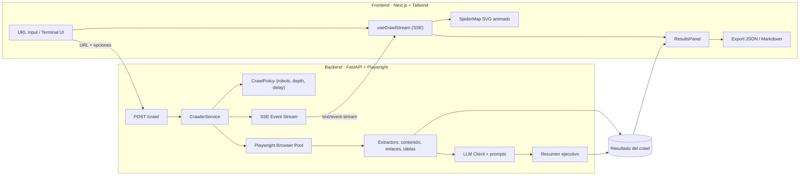
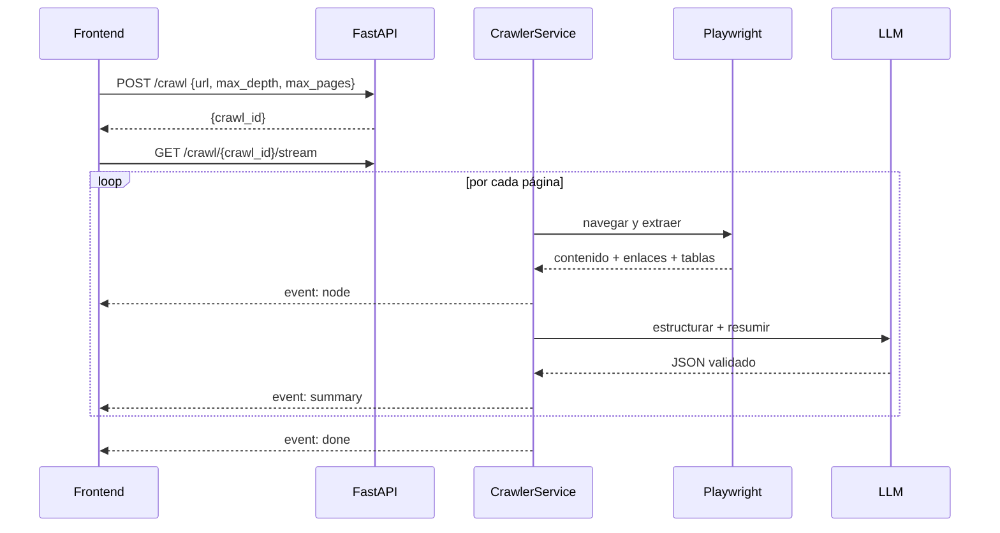

# NeuroSpider

Web Crawler visual con extracción estructurada y resumen ejecutivo impulsado por IA.

> **Estado actual:** Fase 1 — arquitectura base y documentación. La lógica completa de rastreo, IA y visualización en vivo se implementa en la Fase 2.

## Objetivo

El usuario ingresa una URL, un backend con **FastAPI + Playwright** rastrea el sitio (contenido, enlaces y tablas) y un **LLM** produce datos estructurados y un resumen ejecutivo. El frontend **Next.js + Tailwind** muestra en una vista dividida el mapa animado del rastreo y el panel de resultados con exportación a JSON/Markdown.

## Arquitectura



## Flujo de eventos (SSE)



## Estructura del repositorio

```text
neuro-spider-crawler/
├── backend/                 API, crawler, extracción, IA y modelos
│   ├── app/
│   │   ├── api/             rutas HTTP y dependencias
│   │   ├── core/            configuración, logging, eventos
│   │   ├── crawler/         Playwright, política, extractores
│   │   ├── ai/              cliente LLM, prompts, esquemas
│   │   ├── models/          contratos Pydantic
│   │   └── services/        orquestación y exportación
│   └── tests/
├── frontend/                App Router, componentes, hooks y store
├── docs/                    arquitectura, contrato de API, roadmap
├── AGENTS.md                reglas de desarrollo
└── README.md
```

## Stack

| Capa | Tecnologías |
| --- | --- |
| Backend | Python 3.12+, FastAPI, Playwright, Pydantic v2, pytest |
| IA | Cliente LLM configurable (OpenAI-compatible), salida validada con Pydantic |
| Frontend | Next.js (App Router), React, TypeScript, Tailwind CSS, Zustand |
| Tiempo real | Server-Sent Events (SSE) |
| Calidad | Conventional Commits, ruff/mypy (backend), ESLint/tsc (frontend) |

## Puesta en marcha (Fase 2)

```bash
# Backend
cd backend
py -m venv .venv
.venv\Scripts\activate
pip install -r requirements.txt
playwright install chromium
uvicorn app.main:app --reload --port 8000

# Frontend
cd frontend
npm install
npm run dev
```

Frontend: `http://localhost:3000` · Backend: `http://localhost:8000/docs`

## Convenciones

Los cambios deben seguir las reglas de [`AGENTS.md`](AGENTS.md) y los contratos de [`docs/api-contract.md`](docs/api-contract.md).
